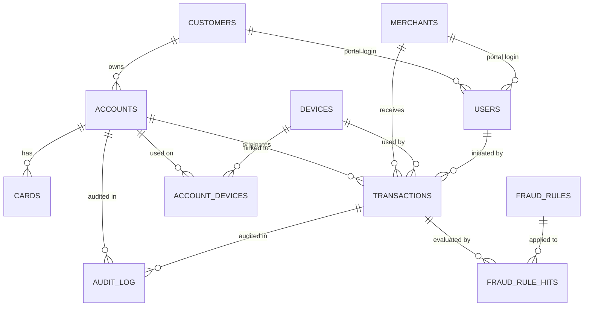

<<<<<<< HEAD
# SentinelPay — Financial Fraud Detection & Payment Transaction System

A database-centric DBMS Lab project that goes well beyond CRUD: a **normalized
relational schema**, **ACID-compliant transaction processing under concurrency**,
and a **rule-based fraud-detection engine implemented inside the database**
(triggers, stored procedures, views, and rule-engine tables), wrapped by a
Node.js API and a vanilla HTML/CSS/JS dashboard.

> Target engine: **MySQL / MariaDB via XAMPP** (localhost).
> Backend: **Node.js (Express)** · Frontend: **Vanilla HTML + CSS + JS**.

---

## 1. Highlights

| Area | What is implemented |
|------|---------------------|
| **Schema** | 12 interrelated, 3NF/BCNF tables with PK/FK/UNIQUE/CHECK constraints and indexes |
| **ACID** | Stored procedures (`sp_deposit`, `sp_withdraw`, `sp_transfer`, `sp_payment`, `sp_reverse_transaction`) using `SELECT ... FOR UPDATE` row locks, atomic commit/rollback, configurable isolation levels |
| **Concurrency** | Pessimistic row locking + deadlock-safe lock ordering + `version` columns; verified by a stress test that proves no lost updates |
| **Fraud engine** | 8 data-driven rules evaluated by `sp_evaluate_transaction`, invoked by every money-move procedure; every evaluation is stored in `fraud_rule_hits` |
| **Relationship detection** | Views `v_fraud_ring_devices` and `v_shared_ip_ring` surface accounts/customers sharing devices or IPs |
| **Audit / non-repudiation** | Append-only `audit_log` populated by triggers; `UPDATE`/`DELETE` on it are physically blocked |
| **Access control** | Application RBAC (JWT roles) + database-level roles/views (customer / merchant / analyst / admin) |
| **Dashboard** | Live overview, flagged-transaction work queue, rule statistics, fraud rings, top-risk accounts, audit trail, blacklist management |

---

## 2. Technology stack

- **Database:** MySQL 8 (or the MariaDB shipped with **XAMPP**) — triggers, stored
  procedures, isolation control, views.
- **Backend / API:** Node.js + Express, `mysql2` connection pool, JWT auth, bcrypt.
- **Frontend:** Vanilla HTML + CSS + JS (no framework) — admin/analyst dashboard,
  customer and merchant portals.
- **Version control:** Git.

---

## 3. Project structure

```
fraud detection project/
├── database/                 -- run in this order
│   ├── 01_schema.sql         -- DDL: 12 tables, constraints, indexes, rules catalogue
│   ├── 02_procedures.sql     -- ACID procedures + fraud-scoring engine + ring view
│   ├── 03_triggers.sql       -- audit-log + device-stamp + append-only enforcement
│   ├── 04_views.sql          -- RBAC / reporting / relationship views
│   ├── 05_rbac.sql           -- database roles + demo users (optional)
│   └── 06_seed.sql           -- master-data seed
├── src/
│   ├── config/               -- env + pooled connection + transaction helper
│   ├── middleware/           -- JWT auth, RBAC guard, error handling
│   ├── routes/               -- auth, accounts, transactions, fraud, dashboard
│   ├── services/             -- business logic (calls stored procedures)
│   └── server.js             -- Express app + static frontend
├── public/                   -- vanilla HTML/CSS/JS UI
│   ├── index.html            -- login
│   ├── customer.html         -- customer portal
│   ├── merchant.html         -- merchant settlement portal
│   ├── dashboard.html        -- fraud-analyst / admin dashboard
│   └── assets/{css,js}
├── scripts/
│   ├── setup-db.js           -- creates schema, seeds users + synthetic transactions
│   ├── simulate-fraud.js     -- injects synthetic fraud patterns
│   └── stress-test.js        -- concurrency / lost-update test
├── docker-compose.yml        -- optional MySQL container (XAMPP is the primary path)
├── .env.example
└── package.json
```

---

## 4. Entity–Relationship model



**Entities (12):** `customers`, `users`, `accounts`, `cards`, `merchants`,
`devices`, `account_devices`, `transactions`, `fraud_rules`, `fraud_rule_hits`,
`blacklist`, `audit_log`.

**Normalization notes**

- All non-key attributes depend only on the whole primary key (3NF) and there
  are no transitive dependencies; `account_devices` resolves the M:N
  relationship between accounts and devices.
- Money is `DECIMAL(15,2)` (never `FLOAT`) to avoid rounding drift.
- `users` centralizes identities and maps 1:1 (optionally) to a customer or a
  merchant, keeping role data out of the core financial tables.
- `fraud_rules` (configuration) is separated from `fraud_rule_hits` (facts),
  so rules can be tuned without touching historical evaluations.

An equivalent text relationship list is in §10 (CO–PO evidence).

---

## 5. Setup with XAMPP (recommended)

### 5.1 Start XAMPP
1. Open the **XAMPP Control Panel**.
2. Start **MySQL** (Apache is optional — the Node server hosts the frontend).

XAMPP's MySQL listens on `127.0.0.1:3306` with user `root` and an empty password
by default.

### 5.2 Install backend dependencies
```powershell
npm install
```

### 5.3 Configure environment
```powershell
Copy-Item .env.example .env
```
Edit `.env` if your XAMPP MySQL uses a password. Defaults already match XAMPP:
```
DB_HOST=127.0.0.1
DB_PORT=3306
DB_USER=root
DB_PASSWORD=
DB_NAME=fraud_detection
```

### 5.4 Create the schema, seed data, and demo users
```powershell
npm run db:setup
```
This runs the six SQL scripts in order, seeds application users, and injects
legitimate + fraudulent synthetic transactions through the stored procedures.
You should see a summary with flagged/quarantined counts and rule-match tallies.

### 5.5 Run the app
```powershell
npm start
```
Open **http://localhost:3000** and sign in.

### Demo logins
| Role | Username | Password |
|------|----------|----------|
| Admin | `admin` | `admin123` |
| Fraud analyst | `analyst` | `analyst123` |
| Customer | `customer1` / `customer2` | `customer123` |
| Merchant | `merchant1` / `merchant2` | `merchant123` |

---

## 6. Manual SQL testing (phpMyAdmin or mysql CLI)

The procedures are transaction-agnostic — wrap calls in a transaction:

```sql
START TRANSACTION;
CALL sp_transfer(5, 1, 250.00, 1, NULL, '198.51.100.9', NULL, NULL,
                 @t_out, @t_in, @risk, @status);
SELECT @t_out AS out_txn, @t_in AS in_txn, @risk AS risk_score, @status AS status;
COMMIT;
```

Inspect the engine's decisions:

```sql
SELECT * FROM v_flagged_transactions LIMIT 20;   -- analyst queue
SELECT * FROM v_fraud_ring_devices;              -- shared-device rings
SELECT * FROM v_shared_ip_ring;                  -- shared-IP rings
SELECT * FROM v_rule_hit_stats;                  -- which rules fire
SELECT * FROM v_recent_audit LIMIT 50;           -- immutable audit trail
```

The append-only guarantee is easy to demonstrate:
```sql
UPDATE audit_log SET action = 'tampered' WHERE log_id = 1;  -- ERROR 45000
```

---

## 7. Concurrency & fraud simulation

**Concurrency (no lost updates / no overdrafts):**
```powershell
npm run stress
```
Fires hundreds of simultaneous transfers in both directions, then verifies the
total balance is conserved and that concurrent withdrawals never overdraw.

**Inject synthetic fraud patterns:**
```powershell
npm run simulate
```
Generates rapid-fire withdrawals (velocity), repeated near-threshold amounts
(structuring), a high-value transfer, impossible-travel geo jumps, shared-device
activity, and blacklisted-IP/merchant transactions.

---

## 8. Fraud rule catalogue

| Code | Type | Trigger | Weight |
|------|------|---------|--------|
| `VELOCITY_TXN` | velocity | > 5 transactions / account / 60 s | 20 |
| `VELOCITY_WITHDRAW` | velocity | > 3 withdrawals / account / 300 s | 25 |
| `HIGH_AMOUNT` | threshold | amount > 10,000 | 20 |
| `STRUCTURING` | structuring | > 2 transactions in the 9,000–9,999 band / 10 min | 30 |
| `GEO_MISMATCH` | geo | two transactions > 500 km apart / 30 min | 40 |
| `DEVICE_REUSE` | device | device fingerprint used by > 1 customer | 40 |
| `BLACKLIST_IP` | blacklist | source IP is blacklisted | 45 |
| `BLACKLIST_MERCHANT` | blacklist | merchant is blacklisted | 45 |

**Scoring:** `risk_score = min(100, Σ weight of matched rules)`.
Status: `>= 70 → quarantined`, `>= 40 → flagged`, else `completed`.

---

## 9. API reference

All endpoints are under `/api`. Authenticated endpoints expect
`Authorization: Bearer <token>`.

| Method | Path | Roles | Purpose |
|--------|------|-------|---------|
| POST | `/auth/login` | public | Obtain a JWT |
| GET | `/auth/me` | any | Current profile |
| GET | `/accounts` | any | Accounts visible to the caller |
| GET | `/accounts/:id` | any | Account detail |
| GET | `/transactions` | any | Transaction history (role-filtered) |
| GET | `/transactions/:id` | any | Transaction + its rule hits |
| POST | `/transactions/deposit` | customer, admin | Deposit |
| POST | `/transactions/withdraw` | customer, admin | Withdraw |
| POST | `/transactions/transfer` | customer, admin | Transfer |
| GET | `/fraud/flagged` | analyst, admin | Flagged/quarantined queue |
| GET | `/fraud/rules` | analyst, admin | Rules + hit statistics |
| GET | `/fraud/rings/devices` | analyst, admin | Shared-device rings |
| GET | `/fraud/rings/ips` | analyst, admin | Shared-IP rings |
| GET | `/fraud/top-risk` | analyst, admin | Highest-risk accounts |
| GET/POST | `/fraud/blacklist` | analyst, admin | View / add blacklist entries |
| POST | `/fraud/transactions/:id/reverse` | analyst, admin | Reverse a transaction |
| POST | `/fraud/recompute-risk` | admin | Recompute customer risk scores |
| GET | `/dashboard/summary` | analyst, admin | Daily + overall KPIs |
| GET | `/dashboard/audit` | analyst, admin | Audit trail |
| GET | `/dashboard/merchant-settlement` | merchant, analyst, admin | Settlement report |
| GET | `/health` | public | DB connectivity probe |

---

## 10. Mapping to the project proposal

- **Objectives 1–2 (normalized schema, ACID):** `database/01_schema.sql`,
  `database/02_procedures.sql`, plus the `scripts/stress-test.js` evidence.
- **Objective 3 (rule engine via triggers/procedures):** `sp_evaluate_transaction`,
  `database/03_triggers.sql`, `fraud_rules` / `fraud_rule_hits`.
- **Objective 4 (relationship / graph queries):** `v_fraud_ring_devices`,
  `v_shared_ip_ring` (self-joins / aggregation over the account–device–IP graph).
- **Objective 5 (RBAC):** `database/05_rbac.sql` (DB roles) + JWT role middleware.
- **Objective 6 (dashboard/reporting):** `dashboard.html`, `v_*` reporting views.
- **Auditability / non-repudiation:** append-only `audit_log` + immutability triggers.
- **P1–P7 / K3–K8 / CO–PO:** satisfied as described in the proposal's §8–§9; the
  implemented DDL, procedures, views, and dashboard are the concrete evidence.

---

## 11. Troubleshooting

| Symptom | Fix |
|---------|-----|
| `ECONNREFUSED 127.0.0.1:3306` | Start **MySQL** in the XAMPP Control Panel |
| `Access denied for user 'root'` | Set `DB_PASSWORD` in `.env` to your XAMPP root password |
| Port 3306 already in use | Stop other MySQL services, or change XAMPP's port and update `.env` |
| `npm run db:setup` fails on `05_rbac.sql` | Expected on MariaDB/XAMPP — RBAC statements are optional and skipped automatically |
| Frontend shows no data | Run `npm run db:setup` first so the database exists |

---

## 12. Notes

- The optional `docker-compose.yml` path is provided only as an alternative;
  **XAMPP is the intended local engine**.
- Never commit your `.env` (it is git-ignored).
=======
# Financial-Fraud-Detection-and-Payment-Transaction-System
>>>>>>> c9b27587d645a1af280faeb78857fdd218805ccb
